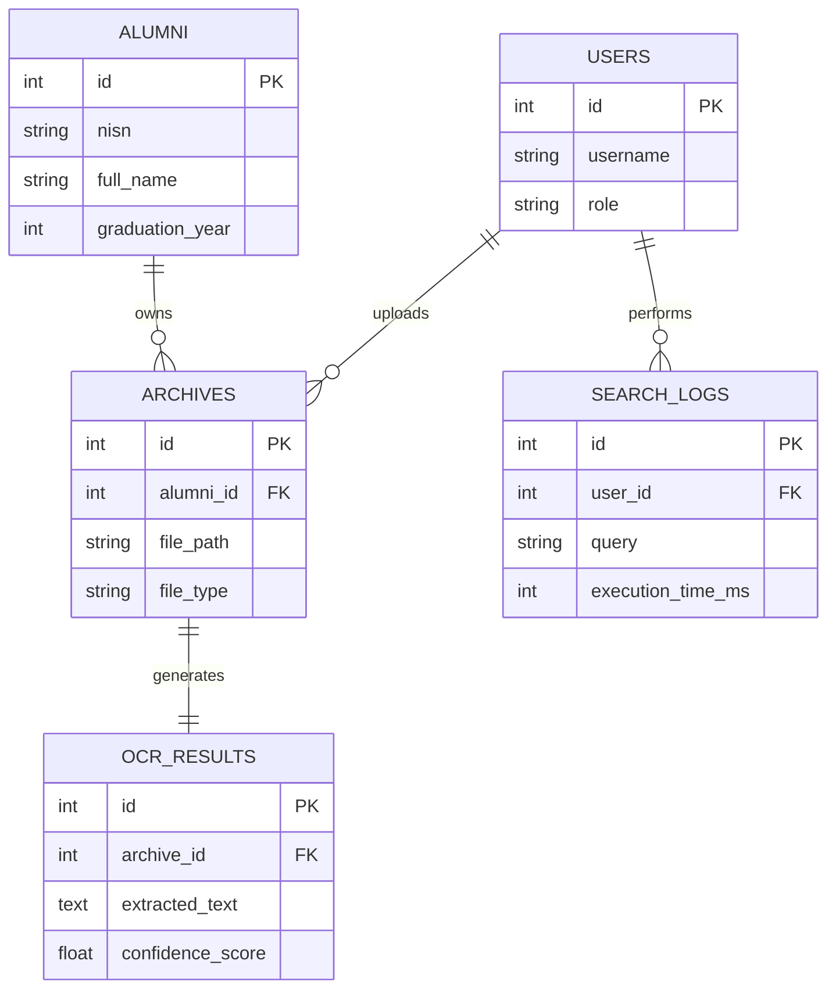

# Entity Relationship Diagram (ERD)
## Alumni Smart Archive System

The system uses a relational database (MySQL) with the following structure:

### Entities

1.  **Users (`users`)**
    *   Stores information about system users (Staff/Admin).
    *   **PK**: `id`
    *   Fields: `username`, `password_hash`, `role`

2.  **Alumni (`alumni`)**
    *   Master data for alumni.
    *   **PK**: `id`
    *   Fields: `nisn` (Unique), `full_name`, `graduation_year`, `birth_date`, `address`
    *   **Relationships**: One-to-Many with `archives`.

3.  **Archives (`archives`)**
    *   Represents digital files (scanned documents).
    *   **PK**: `id`
    *   **FK**: `alumni_id` (Links to Alumni), `uploaded_by` (Links to Users)
    *   Fields: `file_path`, `file_type`, `uploaded_at`
    *   **Relationships**: One-to-One with `ocr_results`.

4.  **OCR Results (`ocr_results`)**
    *   Stores text extracted from the archive by the AI service.
    *   **PK**: `id`
    *   **FK**: `archive_id` (Unique Link to Archives)
    *   Fields: `extracted_text`, `confidence_score`, `status`

5.  **Search Logs (`search_logs`)**
    *   Logs user search activities for performance evaluation metrics.
    *   **PK**: `id`
    *   **FK**: `user_id` (Links to Users)
    *   Fields: `query`, `results_count`, `execution_time_ms`, `timestamp`

### Diagram Representation (Mermaid)

