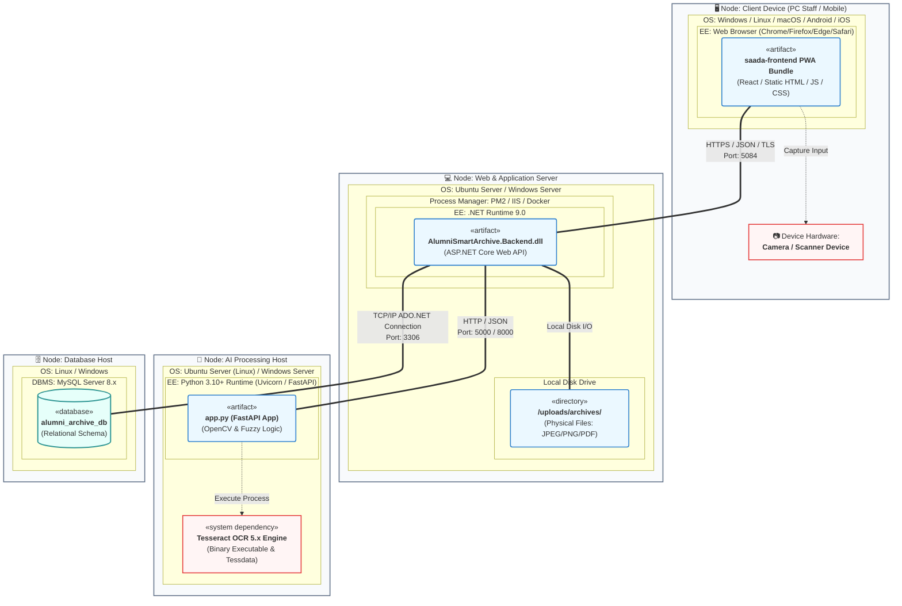

# Diagram Deployment (Deployment Diagram)
## Sistem Alumni Smart Archive

Diagram Deployment menunjukkan susunan fisik dari infrastruktur perangkat keras (node) dan bagaimana artefak-artefak perangkat lunak (artifacts) dideploy di dalam node tersebut. Komunikasi antar node digambarkan lengkap dengan protokol dan port yang digunakan.

---

## 📊 Visualisasi Diagram Deployment (Mermaid)

---

## 📝 Penjelasan Detail Node & Protokol Komunikasi

### 1. Node: Client Device (PC Staff / Mobile)
Perangkat fisik yang digunakan oleh pengguna (Staf Tata Usaha) untuk mengakses sistem.
*   **Execution Environment (EE)**: Browser modern (Google Chrome, Mozilla Firefox, Microsoft Edge, Safari) yang mendukung teknologi HTML5, ES6+, Service Worker, dan Web Camera API.
*   **Artefak**: `saada-frontend PWA Bundle` yang diunduh dari server saat halaman pertama diakses. Komponen frontend ini berjalan sepenuhnya di sisi klien (*client-side rendering*).
*   **Hardware Interface**: Web Camera API browser bertindak sebagai jembatan untuk mengendalikan perangkat kamera fisik (baik kamera HP bawaan, kamera terintegrasi laptop, maupun webcam eksternal) untuk menangkap citra dokumen fisik.

### 2. Node: Web & Application Server
Server tempat berjalannya logika utama sistem *Alumni Smart Archive*. Node ini dapat dideploy secara lokal (on-premise) menggunakan server sekolah, maupun di cloud (Virtual Private Server - VPS).
*   **Operating System**: Windows Server atau Linux Ubuntu Server.
*   **Process Manager / IIS**: PM2 (Process Manager 2) digunakan untuk mengelola kelangsungan proses backend agar selalu *up and running* di latar belakang.
*   **Execution Environment**: *.NET Runtime 9.0* sebagai platform eksekusi backend C#.
*   **Artefak**: `AlumniSmartArchive.Backend.dll` hasil kompilasi program backend ASP.NET Core.
*   **Storage (Local Disk Drive)**: Lokasi penyimpanan fisik file gambar/PDF yang diunggah oleh staf (`/uploads/archives/`). Backend API menulis data file langsung ke harddisk server ini.

### 3. Node: AI Processing Host
Node pemroses kecerdasan buatan. Node ini dapat digabungkan di server yang sama dengan Application Server untuk efisiensi biaya, atau dipisahkan ke VM/Server khusus yang memiliki alokasi CPU/RAM lebih tinggi demi performa komputasi OCR yang cepat.
*   **Execution Environment**: *Python 3.10+ Runtime* dengan server ASGI Uvicorn untuk menjalankan FastAPI.
*   **System Dependency**: *Tesseract OCR 5.x Engine* yang harus terinstal langsung pada sistem operasi server AI, lengkap dengan dataset bahasa (Indonesian dan English `tessdata`) agar Tesseract dapat mengenali teks bahasa Indonesia dengan akurat.
*   **Artefak**: Modul FastAPI Python (`app.py`) beserta pipeline modular untuk OpenCV dan RapidFuzz.

### 4. Node: Database Host
Node penyimpan data relasional.
*   **DBMS**: *MySQL Server 8.x* (atau alternatif MariaDB).
*   **Artefak**: Skema database relasional bernama `alumni_archive_db` yang mengelola data tabel.

---

## 🔌 Protokol Komunikasi Antar Node

1.  **Client Device ➡️ Application Server (Port 5084 / HTTPS)**
    *   **Protokol**: HTTPS (Hypertext Transfer Protocol Secure).
    *   **Fungsi**: Mengirimkan data formulir, kredensial login (JWT), request query pencarian alumni, dan unggahan file gambar dari Frontend ke Backend API dalam format JSON atau multipart/form-data.
2.  **Application Server ➡️ AI Processing Host (Port 5000 / 8000 / HTTP)**
    *   **Protokol**: HTTP (REST API).
    *   **Fungsi**: Backend mengirimkan file gambar arsip ke endpoint `/ocr` atau `/ocr-enhanced` milik AI Service, serta meneruskan query teks ke endpoint `/fuzzy-search` untuk dicocokkan.
3.  **Application Server ➡️ Database Host (Port 3306 / TCP/IP)**
    *   **Protokol**: TCP/IP dengan Connection String MySQL.
    *   **Fungsi**: Eksekusi query SQL (SELECT, INSERT, UPDATE, DELETE) dari DbContext EF Core ke basis data relasional.
