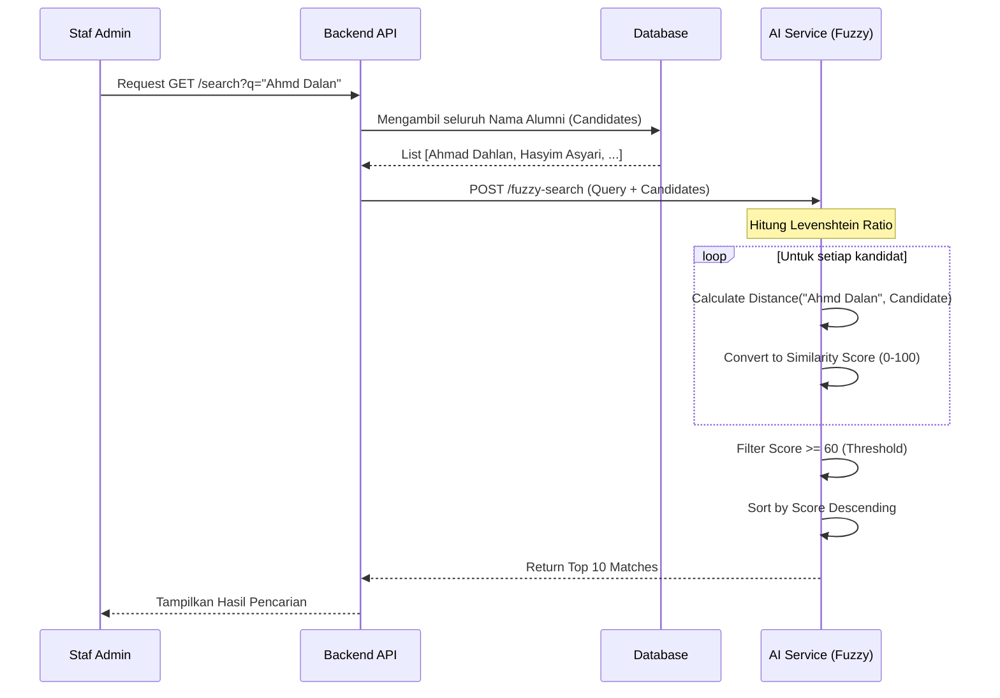

# Diagram Alur Pengenalan Kemiripan Teks (Fuzzy Matching)

Dokumen ini menjelaskan logika pencarian data alumni yang toleran terhadap kesalahan pengetikan (*typo*) menggunakan algoritma *Levenshtein Distance*.

## Diagram Logika Pencarian

## Metode Ilmiah: Levenshtein Distance

Pencarian *fuzzy* didasarkan pada perhitungan jumlah operasi minimum yang diperlukan untuk mengubah satu string ($s_1$) menjadi string lain ($s_2$). Operasi yang diizinkan adalah:
1. **Insertion** (Penyisipan karakter)
2. **Deletion** (Penghapusan karakter)
3. **Substitution** (Penggantian karakter)

### Implementasi Sistem
Sistem menggunakan pustaka **RapidFuzz** (implementasi C++ dari algoritma Levenshtein yang dioptimalkan untuk Python).

**Rumus Similarity Ratio:**
$$
Ratio = \frac{(|s_1| + |s_2|) - Distance}{|s_1| + |s_2|} \times 100
$$

### Contoh Kasus
- **Query**: "Ahmd"
- **Target**: "Ahmad"
- **Jarak (Distance)**: 1 (Menyisipkan 'a')
- **Skor Kemiripan**: Tinggi (>90%) -> Ditampilkan sebagai hasil paling relevan.

Fitur ini mengatasi masalah umum pada pencarian manual database SQL (yang biasanya menggunakan operator `LIKE %...%`) yang tidak dapat menangani *typo*.
